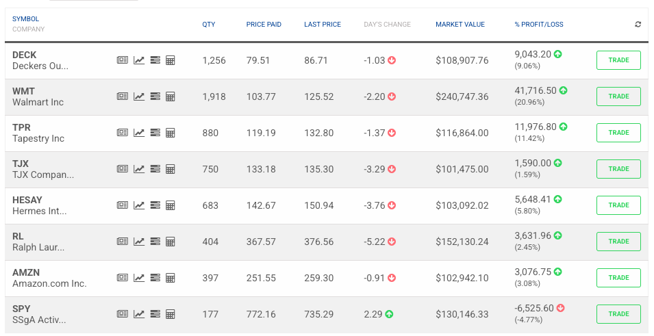

```{r}
library(quantmod)
library(readxl)
library(car)
library(lmtest)
library(dynlm)
library(plm)
library(forecast)
library(tseries)
library(rugarch)
```

# 1. Introducción

El presente proyecto integra los modelos econométricos desarrollados durante el curso para analizar más de diez empresas de los sectores de moda, calzado, lujo y comercio minorista, y fundamentar la estrategia de un portafolio simulado en HowTheMarketWorks.

**Fuentes de datos:** Los modelos intradía de uno y cinco minutos y los datos trimestrales del modelo de panel se obtuvieron de LSEG Workspace (Refinitiv). Los resultados de las regresiones y matrices de correlación se cotejaron con Bloomberg. Las series diarias de precios para las regresiones, los modelos ARIMA y GARCH se obtuvieron mediante getSymbols. Las operaciones del portafolio se realizaron en el simulador HowTheMarketWorks.

**Links de la entrega:**

- Repositorio de GitHub: https://github.com/a00828428-bit/Proyecto-Final-Econometria.git
- Notebook de Google Colab: https://colab.research.google.com/drive/1kAJdja-rlS268MYA-48Rp0jPVOAnrcEX?usp=sharing
- Prompt de GitHub Copilot: https://github.com/copilot/share/c85a503a-41e0-8a73-b910-1007c4cb201a

# 2. Regresión lineal múltiple con datos diarios

Se estimaron cuatro modelos de regresión múltiple con rendimientos diarios para analizar la relación de las principales acciones del portafolio con sus competidores, su sector y el mercado, y respaldar las decisiones de inversión.

```{r}
getSymbols("RL", from = "2023-01-01", to = "2026-10-02")

getSymbols("TPR", from = "2023-01-01", to = "2026-10-02")

getSymbols("PVH", from = "2023-01-01", to = "2026-10-02")

getSymbols("CPRI", from = "2023-01-01", to = "2026-10-02")
```
```{r}
rl_close <- (RL$RL.Close)

tpr_close <- (TPR$TPR.Close)

pvh_close <- (PVH$PVH.Close)

cpri_close <- (CPRI$CPRI.Close)
```

```{r}
rl_ret <- dailyReturn(rl_close)

tpr_ret <- dailyReturn(tpr_close)

pvh_ret <- dailyReturn(pvh_close)

cpri_ret <- dailyReturn(cpri_close)
```

Primero se crean las variables para la primera regresión múltiple, en la que se analiza a Ralph Lauren en función de sus competidores directos del sector de moda premium. Las variables a utilizar son las siguientes:

- **RL (Ralph Lauren):** variable dependiente.
- **TPR (Tapestry):** dueña de Coach y Kate Spade, competidor en el segmento de lujo accesible.
- **PVH (PVH Corp):** dueña de Tommy Hilfiger y Calvin Klein, competidor en moda lifestyle americana.
- **CPRI (Capri Holdings):** dueña de Michael Kors y Jimmy Choo, competidor en lujo accesible.

Los datos se descargan del 1 de enero de 2023 al 2 de octubre de 2026 y se utilizan los rendimientos diarios calculados a partir del precio de cierre.

```{r}
modelo1 <- lm(rl_ret ~ tpr_ret + pvh_ret + cpri_ret)
summary(modelo1)
```
```{r}
confint(modelo1)
```
**Residuales:** Los residuales van de -0.081 a 0.124, con una mediana de -0.0006 y un rango intercuartílico de -0.008 a 0.008. La mediana cercana a cero indica que el modelo no presenta un sesgo importante. Sin embargo, el máximo es mayor en valor absoluto que el mínimo, lo que sugiere que en algunos días Ralph Lauren tuvo rendimientos mucho mayores a los explicados por su sector, posiblemente por noticias propias de la empresa. El error estándar residual es de 0.0149, es decir, el modelo se equivoca en promedio por 1.5% diario.

**R2:** El R2 es de 0.5267 y el R2 ajustado de 0.5252. Los rendimientos de Tapestry, PVH y Capri explican en conjunto aproximadamente el 52.5% de la variación en los rendimientos diarios de Ralph Lauren. El 47.5% restante se debe a factores propios de la empresa.

**Estadístico F:** El estadístico F es de 347.2 con 3 y 936 grados de libertad, y un p-value menor a 2.2e-16. Se rechaza la hipótesis de que todos los coeficientes son iguales a cero, por lo que el modelo en conjunto es significativo.

**P-values y significancia:** El intercepto (p = 0.0837) no es significativo al 5%, por lo que no hay evidencia de un rendimiento adicional de Ralph Lauren independiente de su sector. Las tres variables son significativas al 0.1% y tienen efecto positivo. Tapestry presenta el mayor coeficiente (0.428): por cada 1% que se mueve Tapestry, Ralph Lauren se mueve en promedio 0.43% en la misma dirección, manteniendo constantes las demás variables. PVH tiene un coeficiente de 0.209 y Capri de 0.101, lo que indica una relación más débil con estos competidores.

**Conclusión:** Ralph Lauren tiene una relación positiva y significativa con sus competidores del sector de moda premium, siendo Tapestry el que mejor explica sus movimientos. El sector explica poco más de la mitad de la variación de sus rendimientos, lo que indica que la empresa también responde de manera importante a factores propios.

**Intervalos de confianza:** Con un nivel de confianza del 95%, el intervalo del intercepto va de -0.0001 a 0.0018; al incluir el cero, se confirma que no es significativo. Los intervalos de las tres variables independientes son completamente positivos y no incluyen el cero, lo que confirma su significancia. Por cada 1% de movimiento, el efecto sobre Ralph Lauren se encuentra entre 0.38% y 0.47% para Tapestry, entre 0.17% y 0.25% para PVH, y entre 0.07% y 0.13% para Capri. Además, los intervalos no se traslapan entre sí, lo que indica que la diferencia en la influencia de cada competidor es estadísticamente clara: Tapestry es el que más explica los movimientos de Ralph Lauren, seguido de PVH y, por último, Capri.

**Significancia estadística y práctica:** Aunque las tres variables son estadísticamente significativas, su importancia práctica difiere. El efecto de Tapestry (0.43) es más de cuatro veces mayor que el de Capri (0.10), por lo que, en términos prácticos, Tapestry es el competidor más relevante para explicar los movimientos de Ralph Lauren.

**Análisis de varianza:** La prueba F evalúa la hipótesis nula de que todos los coeficientes de pendiente son simultáneamente iguales a cero. Con un estadístico F de 347.2 y un p-value menor a 2.2e-16, se rechaza dicha hipótesis, por lo que el modelo en su conjunto es significativo.

**Multicolinealidad:**
```{r}
vif(modelo1)
```

Los valores del factor de inflación de la varianza (VIF) son de 1.26 para Tapestry, 1.42 para PVH y 1.17 para Capri, todos muy por debajo del límite de 5. Esto indica que no existe multicolinealidad en el modelo: aunque las tres empresas pertenecen al mismo sector, cada una aporta información propia, por lo que es posible estimar de forma confiable el efecto individual de cada competidor sobre Ralph Lauren. No es necesario aplicar ninguna corrección.

**Heterocedasticidad:**
```{r}
bptest(modelo1)
```
La prueba de Breusch-Pagan arroja un estadístico de 8.26 con 3 grados de libertad y un p-value de 0.0409. Al ser menor a 0.05, se rechaza la hipótesis de homocedasticidad, por lo que el modelo presenta heterocedasticidad al 5% de significancia, aunque de forma leve, ya que no se rechazaría al 1%. Esto es común en rendimientos de acciones, donde la volatilidad cambia entre periodos tranquilos y periodos con noticias relevantes. La heterocedasticidad no afecta a los coeficientes estimados, pero sí puede afectar la confiabilidad de los errores estándar y los p-values.

```{r}
gqtest(modelo1)
```
Para el segundo modelo de regresión múltiple se analiza a Tapestry en función de empresas del sector de comercio minorista, con el objetivo de evaluar si los rendimientos de una empresa de moda dependen del desempeño del comercio en general. Las variables a utilizar son las siguientes:

- **TPR (Tapestry):** variable dependiente.
- **AMZN (Amazon):** comercio electrónico.
- **TJX (TJX Companies):** dueña de TJ Maxx y Marshalls, tiendas de descuento de ropa y artículos para el hogar.
- **WMT (Walmart):** comercio minorista de productos básicos.

Los datos se descargan del 1 de enero de 2023 al 2 de octubre de 2026 y se utilizan los rendimientos diarios calculados a partir del precio de cierre.

```{r}
getSymbols("AMZN", from = "2023-01-01", to = "2026-10-02")

getSymbols("TJX", from = "2023-01-01", to = "2026-10-02")

getSymbols("WMT", from = "2023-01-01", to = "2026-10-02")

AMZN <- na.omit(AMZN)

TJX <- na.omit(TJX)

WMT <- na.omit(WMT)

```

```{r}
amzn_close <- (AMZN$AMZN.Close)

tjx_close <- (TJX$TJX.Close)

wmt_close <- (WMT$WMT.Close)
```

```{r}
amzn_ret <- dailyReturn(amzn_close)

tjx_ret <- dailyReturn(tjx_close)

wmt_ret <- dailyReturn(wmt_close)
```

```{r}
modelo2 <- lm(tpr_ret ~ amzn_ret + tjx_ret + wmt_ret)
summary(modelo2)
```
**Residuales:** Los residuales van de -0.168 a 0.136, con una mediana prácticamente igual a cero (0.0001) y un rango intercuartílico de -0.0115 a 0.0119. La distribución es bastante simétrica, lo que indica que el modelo no presenta un sesgo importante; sin embargo, los valores extremos son amplios, lo que refleja días con movimientos fuertes de Tapestry que no son explicados por el comercio minorista. El error estándar residual es de 0.0226, es decir, el modelo se equivoca en promedio por 2.3% diario, un error mayor que el del primer modelo.

**R2:** El R2 es de 0.1364 y el R2 ajustado de 0.1336. Los rendimientos de Amazon, TJX y Walmart explican en conjunto aproximadamente el 13.4% de la variación en los rendimientos diarios de Tapestry. Es un poder explicativo bajo, lo que indica que los movimientos de Tapestry dependen en mayor medida de factores propios y de su sector que del desempeño del comercio minorista en general.

**Pruebas de hipótesis:** Para cada coeficiente se plantea la hipótesis nula H0: β = 0 frente a la alternativa H1: β ≠ 0, con un nivel de significancia de 5%. Bajo el enfoque de prueba de significancia, los estadísticos t de Amazon (6.15) y TJX (7.70) superan el valor de 2, por lo que, de acuerdo con la regla práctica "2-t", se rechaza la hipótesis nula para ambas variables; esto se confirma con p-values prácticamente iguales a cero. En cambio, Walmart tiene un estadístico t de 1.47 y un p-value de 0.141, por lo que no se rechaza la hipótesis nula: no hay evidencia suficiente para afirmar que sus rendimientos influyan en los de Tapestry. De igual forma, el intercepto (t = 1.04, p = 0.297) no es significativo.

**Significancia estadística y práctica:** Entre las variables significativas, TJX presenta el mayor efecto: por cada 1% que se mueve TJX, Tapestry se mueve en promedio 0.54% en la misma dirección, manteniendo constantes las demás variables. Amazon tiene un efecto menor, de 0.23%. Esto es consistente con que TJX comercializa ropa y accesorios, productos más cercanos a los de Tapestry, mientras que Walmart se enfoca en productos básicos que no se relacionan con el segmento de lujo accesible.

**Análisis de varianza:** La prueba F evalúa la hipótesis nula de que todos los coeficientes de pendiente son simultáneamente iguales a cero. Con un estadístico F de 49.27 con 3 y 936 grados de libertad y un p-value menor a 2.2e-16, se rechaza dicha hipótesis, por lo que el modelo en su conjunto es significativo, aunque su poder explicativo sea bajo.

```{r}
confint(modelo2)
```
**Intervalos de confianza:** Con un nivel de confianza del 95%, los intervalos de Amazon (0.154 a 0.299) y TJX (0.403 a 0.678) son completamente positivos y no incluyen el cero, por lo que, bajo el enfoque del intervalo de confianza, se rechaza la hipótesis nula y se confirma su significancia. Por cada 1% de movimiento, el efecto sobre Tapestry se encuentra entre 0.15% y 0.30% para Amazon, y entre 0.40% y 0.68% para TJX. Como ambos intervalos no se traslapan, se concluye que TJX tiene una relación más fuerte con Tapestry que Amazon. En cambio, el intervalo de Walmart (-0.029 a 0.202) incluye el cero, por lo que no se rechaza la hipótesis nula, lo que confirma que no existe evidencia de una relación significativa. Lo mismo ocurre con el intercepto, cuyo intervalo va de -0.0007 a 0.0022.

```{r}
vif(modelo2)
```

**Multicolinealidad:** Los valores del factor de inflación de la varianza (VIF) son de 1.05 para Amazon, 1.20 para TJX y 1.18 para Walmart, todos muy cercanos a 1 y por debajo del límite de 5. Esto indica que no existe multicolinealidad en el modelo: aunque las tres empresas pertenecen al comercio minorista, sus modelos de negocio son distintos, por lo que cada una aporta información propia. No es necesario aplicar ninguna corrección.

```{r}
bptest(modelo2)

gqtest(modelo2)
```
**Heterocedasticidad:** La prueba de Breusch-Pagan resulta en un estadístico de 1.64 con 3 grados de libertad y un p-value de 0.651, por lo que no se rechaza la hipótesis de homocedasticidad; esto indica que la varianza de los errores no depende de los valores de las variables independientes. Sin embargo, la prueba de Goldfeld-Quandt arroja un estadístico de 1.53 con 466 grados de libertad en cada segmento y un p-value de 2.28e-06, por lo que se rechaza la homocedasticidad. Dado que los datos están ordenados cronológicamente, este resultado indica que la varianza de los errores es aproximadamente 53% mayor en la segunda mitad del periodo. En conjunto, ambas pruebas sugieren que la heterocedasticidad del modelo es de carácter temporal: los rendimientos de Tapestry se volvieron más volátiles en el periodo reciente por factores propios de la empresa, no relacionados con el comercio minorista.

**Conclusión:** Los rendimientos de Tapestry presentan una relación positiva y significativa con TJX y Amazon, siendo TJX la empresa con mayor relación, lo que es consistente con que también comercializa ropa y accesorios. Walmart no resulta significativa, lo que puede explicarse por su carácter defensivo frente al carácter cíclico de Tapestry. El modelo es significativo en conjunto, pero el comercio minorista explica solo el 13.4% de la variación de Tapestry, muy por debajo del poder explicativo del primer modelo, lo que indica que las empresas de moda dependen más de su propio sector que del comercio en general. No se detectó multicolinealidad, y la heterocedasticidad identificada es de carácter temporal, asociada a una mayor volatilidad de Tapestry en el periodo reciente.

Para el tercer modelo de regresión múltiple se analiza a Deckers Brands, dueña de las marcas Hoka y UGG, en función del mercado en general, del sector de consumo discrecional y de un competidor directo, con el objetivo de evaluar qué tanto dependen sus rendimientos de la economía en general. Las variables a utilizar son las siguientes:

- **DECK (Deckers Brands):** variable dependiente.
- **SPY (SPDR S&P 500 ETF):** representa el desempeño del mercado accionario de Estados Unidos.
- **XLY (Consumer Discretionary Select Sector SPDR):** representa al sector de consumo discrecional, es decir, empresas de bienes no esenciales.
- **NKE (Nike):** competidor directo en calzado deportivo.

Los datos se descargan del 1 de enero de 2023 al 2 de octubre de 2026 y se utilizan los rendimientos diarios calculados a partir del precio de cierre.

```{r}
getSymbols("DECK", from = "2023-01-01", to = "2026-10-02")

getSymbols("SPY", from = "2023-01-01", to = "2026-10-02")

getSymbols("XLY", from = "2023-01-01", to = "2026-10-02")

getSymbols("NKE", from = "2023-01-01", to = "2026-10-02")

DECK <- na.omit(DECK)

SPY <- na.omit(SPY)

XLY <- na.omit(XLY)

NKE <- na.omit(NKE)
```
```{r}
deck_close <- (DECK$DECK.Close)

spy_close <- (SPY$SPY.Close)

xly_close <- (XLY$XLY.Close)

nke_close <- (NKE$NKE.Close)
```

```{r}
deck_ret <- dailyReturn(deck_close)

spy_ret <- dailyReturn(spy_close)

xly_ret <- dailyReturn(xly_close)

nke_ret <- dailyReturn(nke_close)
```

```{r}
modelo3 <- lm(deck_ret ~ spy_ret + xly_ret + nke_ret)
summary(modelo3)
```
```{r}
cor(spy_ret, xly_ret)
```
**Correlación entre SPY y XLY:** La correlación entre los rendimientos del S&P 500 y del sector de consumo discrecional es de 0.85, lo que indica una relación positiva muy fuerte. Esto se explica porque las empresas que integran el XLY forman parte también del S&P 500, por lo que ambos índices tienden a moverse en la misma dirección. Esta alta correlación es una señal de posible multicolinealidad entre ambas variables.

```{r}
vif(modelo3)
```

Quitamos cada una de las variables para corregirlas

```{r}
modelo3b <- lm(deck_ret ~ spy_ret + nke_ret)
summary(modelo3b)
vif(modelo3b)

modelo3c <- lm(deck_ret ~ xly_ret + nke_ret)
summary(modelo3c)
vif(modelo3c)
```

**Corrección de la multicolinealidad:** Se estimaron dos modelos alternativos, eliminando en cada uno una de las variables con multicolinealidad. Al eliminar XLY, la variable SPY se vuelve altamente significativa (t = 10.91), y su error estándar disminuye de 0.154 a 0.090, lo que confirma que la multicolinealidad era la causa de su falta de significancia en el modelo original. Sin embargo, el R2 ajustado de este modelo es de 0.2211. Al eliminar SPY, la variable XLY se mantiene altamente significativa (t = 12.48) y el R2 ajustado es de 0.2472, prácticamente igual al del modelo original (0.2483), lo que indica que SPY no aportaba información adicional una vez incluido el sector de consumo discrecional. En ambos casos los VIF disminuyen a valores cercanos a 1. Por lo tanto, se elige el modelo sin SPY por tener un mayor poder explicativo.

```{r}
getSymbols("CROX", from = "2023-01-01", to = "2026-10-02")

CROX <- na.omit(CROX)

crox_close <- (CROX$CROX.Close)

crox_ret <- dailyReturn(crox_close)

modelo3d <- lm(deck_ret ~ xly_ret + nke_ret + crox_ret)
summary(modelo3d)
vif(modelo3d)
```

**Modelo corregido:** Para cumplir con un mínimo de tres variables independientes, se incorporó a Crocs (CROX), empresa de calzado casual, en sustitución de SPY. Los valores del VIF son de 1.40 para XLY, 1.33 para Nike y 1.25 para Crocs, todos cercanos a 1, por lo que se confirma que el modelo final no presenta multicolinealidad.

**Residuales:** Los residuales van de -0.189 a 0.192, con una mediana prácticamente igual a cero (-0.0002) y un rango intercuartílico de -0.0112 a 0.0105. La distribución es simétrica, por lo que el modelo no presenta un sesgo importante, aunque los valores extremos cercanos a 19% reflejan días con movimientos muy fuertes de Deckers. El error estándar residual es de 0.0227, es decir, el modelo se equivoca en promedio por 2.3% diario.

**R2:** El R2 es de 0.3041 y el R2 ajustado de 0.3018. Los rendimientos del sector de consumo discrecional, Nike y Crocs explican en conjunto aproximadamente el 30.2% de la variación en los rendimientos diarios de Deckers, lo que representa una mejora respecto al modelo original (24.8%).

**Pruebas de hipótesis:** Para cada coeficiente se plantea la hipótesis nula H0: β = 0 frente a la alternativa H1: β ≠ 0, con un nivel de significancia de 5%. Los estadísticos t de XLY (9.82), Crocs (8.62) y Nike (3.56) superan el valor de 2, por lo que, de acuerdo con la regla práctica "2-t", se rechaza la hipótesis nula para las tres variables; esto se confirma con p-values menores a 0.001. El intercepto (t = 0.23, p = 0.821) no es significativo.

**Significancia estadística y práctica:** XLY presenta el mayor efecto: por cada 1% que se mueve el sector de consumo discrecional, Deckers se mueve en promedio 0.66% en la misma dirección, manteniendo constantes las demás variables. Crocs tiene un efecto de 0.22% y Nike de 0.14%. Destaca que Deckers se relaciona más con Crocs que con Nike, lo cual es consistente con que sus marcas Hoka y UGG, al igual que Crocs, pertenecen al segmento de calzado cómodo y de tendencia, mientras que Nike se enfoca en calzado deportivo tradicional.

**Análisis de varianza:** La prueba F evalúa la hipótesis nula de que todos los coeficientes de pendiente son simultáneamente iguales a cero. Con un estadístico F de 136.3 con 3 y 936 grados de libertad y un p-value menor a 2.2e-16, se rechaza dicha hipótesis, por lo que el modelo en su conjunto es significativo.

```{r}
confint(modelo3d)

bptest(modelo3d)

gqtest(modelo3d)
```
**Heterocedasticidad:** La prueba de Breusch-Pagan arroja un estadístico de 4.44 con 3 grados de libertad y un p-value de 0.218, por lo que no se rechaza la hipótesis de homocedasticidad; esto indica que la varianza de los errores no depende de los valores de las variables independientes. Sin embargo, la prueba de Goldfeld-Quandt arroja un estadístico de 1.54 con 466 grados de libertad en cada segmento y un p-value de 1.83e-06, por lo que se rechaza la homocedasticidad. Dado que los datos están ordenados cronológicamente, este resultado indica que la varianza de los errores es aproximadamente 54% mayor en la segunda mitad del periodo. Al igual que en el segundo modelo, la heterocedasticidad es de carácter temporal, lo que sugiere que los rendimientos de Deckers se volvieron más volátiles en el periodo reciente por factores propios de la empresa.

**Conclusión:** Los rendimientos de Deckers presentan una relación positiva y significativa con el sector de consumo discrecional, Nike y Crocs, siendo el consumo discrecional el factor con mayor relación. En el modelo original se detectó multicolinealidad moderada entre SPY y XLY, que provocó que SPY no resultara significativa; esta se corrigió eliminando SPY e incorporando a Crocs, lo que eliminó la multicolinealidad y aumentó el poder explicativo del modelo de 24.8% a 30.2%. La heterocedasticidad identificada es de carácter temporal, asociada a una mayor volatilidad de Deckers en el periodo reciente.

Adicionalmente, se elaboró un cuarto modelo de regresión múltiple con el fin de incluir marcas de lujo europeo en el portafolio de inversión y contar con un análisis que respalde su incorporación. En este modelo se analiza a Hermès en función de otras empresas del sector de lujo, con el objetivo de evaluar qué tanto dependen sus rendimientos del comportamiento del sector y si puede funcionar como un elemento de diversificación dentro del portafolio. Dado que estas empresas cotizan originalmente en Europa, se utilizan sus ADRs, que operan en Estados Unidos en dólares y en horario estadounidense. Las variables a utilizar son las siguientes:

- **HESAY (Hermès):** variable dependiente. Dueña de bolsas como Birkin y Kelly, en el segmento más alto del lujo.
- **LVMUY (LVMH):** dueña de Louis Vuitton y Dior, el conglomerado más grande del sector de lujo.
- **PPRUY (Kering):** dueña de Gucci, Saint Laurent y Bottega Veneta.
- **BURBY (Burberry):** marca británica de lujo.

Los datos se descargan del 1 de enero de 2023 al 2 de octubre de 2026 y se utilizan los rendimientos diarios calculados a partir del precio de cierre.

```{r}
getSymbols("HESAY", from = "2023-01-01", to = "2026-10-02")

getSymbols("LVMUY", from = "2023-01-01", to = "2026-10-02")

getSymbols("PPRUY", from = "2023-01-01", to = "2026-10-02")

getSymbols("BURBY", from = "2023-01-01", to = "2026-10-02")
```
```{r}
HESAY <- na.omit(HESAY)

LVMUY <- na.omit(LVMUY)

PPRUY <- na.omit(PPRUY)

BURBY <- na.omit(BURBY)
```

```{r}
hesay_close <- (HESAY$HESAY.Close)

lvmuy_close <- (LVMUY$LVMUY.Close)

ppruy_close <- (PPRUY$PPRUY.Close)

burby_close <- (BURBY$BURBY.Close)
```
```{r}
hesay_ret <- dailyReturn(hesay_close)

lvmuy_ret <- dailyReturn(lvmuy_close)

ppruy_ret <- dailyReturn(ppruy_close)

burby_ret <- dailyReturn(burby_close)
```

```{r}
modelo4 <- lm(hesay_ret ~ lvmuy_ret + ppruy_ret + burby_ret)
summary(modelo4)
```
**Residuales:** Los residuales van de -0.116 a 0.052, con una mediana de 0.0007 y un rango intercuartílico de -0.0061 a 0.0068. La mediana cercana a cero indica que el modelo no presenta un sesgo importante; sin embargo, el mínimo es mucho mayor en valor absoluto que el máximo, lo que indica que el modelo no capta algunas caídas fuertes de Hermès, posiblemente asociadas a noticias propias de la empresa. El error estándar residual es de 0.0124, es decir, el modelo se equivoca en promedio por 1.2% diario, el menor error de los cuatro modelos.

**R2:** El R2 es de 0.5701 y el R2 ajustado de 0.5687. Los rendimientos de LVMH, Kering y Burberry explican en conjunto aproximadamente el 56.9% de la variación en los rendimientos diarios de Hermès, el mayor poder explicativo de los cuatro modelos, lo que indica que el sector de lujo europeo se mueve de forma muy conjunta.

**Pruebas de hipótesis:** Para cada coeficiente se plantea la hipótesis nula H0: β = 0 frente a la alternativa H1: β ≠ 0, con un nivel de significancia de 5%. Los estadísticos t de LVMH (21.37) y Burberry (3.56) superan el valor de 2, por lo que, de acuerdo con la regla práctica "2-t", se rechaza la hipótesis nula para ambas variables; esto se confirma con p-values menores a 0.001. En cambio, Kering tiene un estadístico t de 1.38 y un p-value de 0.167, por lo que no se rechaza la hipótesis nula: no hay evidencia suficiente para afirmar que sus rendimientos se relacionen con los de Hermès una vez que se considera a LVMH y Burberry. El intercepto (t = 0.95, p = 0.343) no es significativo.

**Significancia estadística y práctica:** LVMH presenta un efecto muy superior al de las demás variables: por cada 1% que se mueve LVMH, Hermès se mueve en promedio 0.64% en la misma dirección, manteniendo constantes las demás variables. Aunque Burberry es estadísticamente significativa, su efecto es pequeño en términos prácticos (0.07%). Esto indica que Hermès se relaciona principalmente con el líder del sector, y que su sensibilidad es menor a uno, lo que refleja un comportamiento relativamente defensivo dentro del lujo.

**Análisis de varianza:** La prueba F evalúa la hipótesis nula de que todos los coeficientes de pendiente son simultáneamente iguales a cero. Con un estadístico F de 413.7 con 3 y 936 grados de libertad y un p-value menor a 2.2e-16, se rechaza dicha hipótesis, por lo que el modelo en su conjunto es significativo.

```{r}
confint(modelo4)

vif(modelo4)

bptest(modelo4)

gqtest(modelo4)
```

**Intervalos de confianza:** Con un nivel de confianza del 95%, los intervalos de LVMH (0.582 a 0.700) y Burberry (0.031 a 0.107) son completamente positivos y no incluyen el cero, por lo que, bajo el enfoque del intervalo de confianza, se confirma su significancia. Como ambos intervalos no se traslapan, se concluye que LVMH tiene una relación claramente más fuerte con Hermès que Burberry. En cambio, el intervalo de Kering (-0.015 a 0.084) incluye el cero, por lo que no se rechaza la hipótesis nula, lo que confirma que no existe evidencia de una relación significativa. Lo mismo ocurre con el intercepto, cuyo intervalo va de -0.0004 a 0.0012.

**Multicolinealidad:** Los valores del factor de inflación de la varianza (VIF) son de 2.11 para LVMH, 2.27 para Kering y 1.61 para Burberry, todos por debajo del límite de 5, por lo que no existe multicolinealidad relevante en el modelo y no es necesario aplicar ninguna corrección. Esto indica que la falta de significancia de Kering no se debe a su relación con LVMH, sino a que, una vez considerado el líder del sector, los movimientos de Kering no aportan información adicional para explicar a Hermès. Esto puede atribuirse a los problemas específicos que ha enfrentado Kering, en particular con su marca Gucci, que no afectan a Hermès.

**Heterocedasticidad:** La prueba de Breusch-Pagan arroja un estadístico de 6.32 con 3 grados de libertad y un p-value de 0.097, mayor a 0.05, por lo que no se rechaza la hipótesis de homocedasticidad; esto indica que la varianza de los errores no depende de los valores de las variables independientes. Sin embargo, la prueba de Goldfeld-Quandt arroja un estadístico de 2.29 con 466 grados de libertad en cada segmento y un p-value menor a 2.2e-16, por lo que se rechaza la homocedasticidad. Dado que los datos están ordenados cronológicamente, este resultado indica que la varianza de los errores en la segunda mitad del periodo es más del doble que en la primera, la mayor diferencia de los cuatro modelos, lo que sugiere que el sector de lujo ha experimentado un aumento importante en su volatilidad reciente.

**Conclusión:** Los rendimientos de Hermès presentan una relación positiva y significativa con LVMH y Burberry, siendo LVMH, como líder del sector, la que explica la mayor parte de sus movimientos. Kering no resulta significativa, lo que refleja que sus problemas específicos no se trasladan a Hermès. El modelo tiene el mayor poder explicativo de los cuatro (56.9%), lo que indica que el sector de lujo europeo se mueve de forma muy conjunta. La sensibilidad de Hermès frente a LVMH es menor a uno (0.64), lo que confirma su carácter relativamente defensivo dentro del sector. No se detectó multicolinealidad, y la heterocedasticidad identificada es de carácter temporal, asociada a un aumento significativo de la volatilidad en el periodo reciente.

# 3. Modelos de regresión con datos intradía (LSEG)

Se replicaron los modelos de regresión simple y múltiple con rendimientos de uno y cinco minutos del 8 y 9 de octubre de 2026, obtenidos de LSEG Workspace, para comparar los resultados con los modelos de datos diarios.

```{r}
rend_1m <- read_excel("precios_1min.xlsx", sheet = "rendimientos")

rend_5m <- read_excel("precios_5min.xlsx", sheet = "rendimientos")
```

```{r}
modelo1_1m <- lm(rl ~ tpr, data = rend_1m)
summary(modelo1_1m)
```
**Modelo 1 (1 minuto): Ralph Lauren en función de Tapestry.** El modelo utiliza 516 observaciones de rendimientos de un minuto, ya que se eliminaron 264 intervalos en los que alguna de las dos acciones no registró operaciones. El coeficiente de Tapestry es de 0.274 y es altamente significativo (t = 6.82, p = 2.58e-11): por cada 1% que se mueve Tapestry en un minuto, Ralph Lauren se mueve en promedio 0.27% en la misma dirección. El intercepto no es significativo (p = 0.692). Sin embargo, el R2 ajustado es de apenas 0.081, es decir, Tapestry explica solo el 8.1% de la variación minuto a minuto de Ralph Lauren, muy por debajo de lo observado con datos diarios. Esto se explica porque en intervalos tan cortos los precios están dominados por ruido de microestructura del mercado, como el diferencial entre precios de compra y venta y el efecto de órdenes individuales, y porque las acciones no reaccionan exactamente al mismo tiempo ante la misma información, lo que reduce la correlación observada (efecto Epps). El error estándar residual es de 0.0009, es decir, el modelo se equivoca en promedio por 0.09% por minuto.

```{r}
getSymbols("RL", from = "2023-01-01", to = "2026-10-02")

getSymbols("TPR", from = "2023-01-01", to = "2026-10-02")

rl_ret <- dailyReturn(RL$RL.Close)

tpr_ret <- dailyReturn(TPR$TPR.Close)

modelo1_diario <- lm(rl_ret ~ tpr_ret)
summary(modelo1_diario)
```

**Comparación con el modelo original:** Para comparar de forma directa, se estimó también la regresión simple de Ralph Lauren contra Tapestry con datos diarios del 1 de enero de 2023 al 2 de octubre de 2026 (940 observaciones). En ambos modelos la relación es positiva y altamente significativa, y el intercepto no es significativo. Sin embargo, con datos diarios el coeficiente de Tapestry es de 0.568 y el R2 ajustado de 40.5%, mientras que con datos de un minuto el coeficiente disminuye a 0.274 y el R2 ajustado a 8.1%. Es decir, el efecto de Tapestry se reduce a la mitad y su poder explicativo es cinco veces menor en el muy corto plazo. Esto indica que, aunque ambas acciones se mueven juntas en el mediano plazo, minuto a minuto su relación se debilita por el ruido de microestructura del mercado y porque no reaccionan exactamente al mismo tiempo ante la misma información.

```{r}
modelo1_5m <- lm(rl ~ tpr, data = rend_5m)
summary(modelo1_5m)
```
**Modelo 1 (5 minutos): Ralph Lauren en función de Tapestry.** El modelo utiliza 154 observaciones de rendimientos de cinco minutos. El coeficiente de Tapestry es de 0.435 y es altamente significativo (t = 6.47, p = 1.26e-09): por cada 1% que se mueve Tapestry en un intervalo de cinco minutos, Ralph Lauren se mueve en promedio 0.44% en la misma dirección. El intercepto no es significativo (p = 0.352). El R2 ajustado es de 0.211, es decir, Tapestry explica el 21.1% de la variación de Ralph Lauren, y el error estándar residual es de 0.0014, equivalente a 0.14% por intervalo.

**Comparación entre frecuencias:** Al comparar los tres modelos con las mismas acciones, se observa que tanto el coeficiente de Tapestry como el poder explicativo aumentan conforme se amplía el intervalo de tiempo: el coeficiente pasa de 0.274 con datos de un minuto, a 0.435 con datos de cinco minutos y a 0.568 con datos diarios, mientras que el R2 ajustado aumenta de 8.1% a 21.1% y a 40.5%, respectivamente. En los tres casos la relación es positiva y significativa y el intercepto no es significativo. Este patrón es consistente con el efecto Epps: en intervalos muy cortos, el ruido de microestructura del mercado y los pequeños desfases en la reacción de cada acción ante la misma información reducen la correlación observada, mientras que en intervalos más largos estos efectos se diluyen y la relación de fondo entre ambas empresas se vuelve más evidente. Para la estrategia del portafolio, esto implica que la redundancia entre Ralph Lauren y Tapestry es relevante en el mediano plazo, que es el horizonte en el que se toman las decisiones de inversión, y no en el muy corto plazo.

```{r}
modelo2_1m <- lm(rl ~ tpr + pvh + cpri, data = rend_1m)
summary(modelo2_1m)

modelo2_5m <- lm(rl ~ tpr + pvh + cpri, data = rend_5m)
summary(modelo2_5m)
```

**Modelo 2 (1 minuto): Ralph Lauren en función de Tapestry, PVH y Capri.** El modelo utiliza 329 observaciones, ya que se eliminaron 451 intervalos en los que al menos una de las cuatro acciones no registró operaciones. Tapestry (0.195, t = 3.47, p = 0.0006) y PVH (0.102, t = 2.59, p = 0.010) presentan una relación positiva y significativa con Ralph Lauren, mientras que Capri no es significativa (0.012, p = 0.747). El intercepto tampoco es significativo. El R2 ajustado es de 0.077, es decir, las tres variables explican apenas el 7.7% de la variación de Ralph Lauren minuto a minuto, y el modelo en conjunto es significativo (F = 10.08, p = 2.29e-06).

**Comparación con el modelo original:** En el modelo con datos diarios de la Tarea 3, las tres variables eran significativas al 0.1%, con coeficientes de 0.428 para Tapestry, 0.209 para PVH y 0.101 para Capri, y un R2 ajustado de 52.5%. Con datos de un minuto se conserva el orden de importancia de los competidores, pero todos los coeficientes disminuyen aproximadamente a la mitad o menos, PVH reduce su nivel de significancia y Capri deja de ser significativa. La pérdida de significancia de Capri puede atribuirse a su bajo precio por acción (alrededor de 14 dólares), ya que un cambio mínimo de un centavo representa cerca de 0.07%, lo que hace que sus rendimientos de un minuto sean muy discretos y ruidosos. Además, el R2 ajustado (7.7%) es incluso menor al del modelo simple con Tapestry (8.1%), lo que indica que en esta frecuencia agregar más competidores no mejora la capacidad explicativa del modelo.

**Modelo 2 (5 minutos): Ralph Lauren en función de Tapestry, PVH y Capri.** El modelo utiliza 154 observaciones. Tapestry es la única variable significativa (0.393, t = 5.54, p = 1.34e-07), mientras que PVH (p = 0.328), Capri (p = 0.282) y el intercepto (p = 0.499) no son significativos. El R2 ajustado es de 0.218 y el modelo en conjunto es significativo (F = 15.23, p = 1.06e-08).

**Comparación entre frecuencias:** Tapestry es la única variable significativa en las tres frecuencias, y su coeficiente con datos de cinco minutos (0.393) es muy cercano al obtenido con datos diarios (0.428), lo que confirma que es el competidor con la relación más estable con Ralph Lauren. En cambio, PVH y Capri, que eran significativas con datos diarios, pierden significancia en el muy corto plazo. En el caso de PVH, que sí era significativa con datos de un minuto, la pérdida de significancia con datos de cinco minutos puede atribuirse al menor número de observaciones (154 frente a 329), que reduce la capacidad de detectar efectos pequeños. Además, el R2 ajustado del modelo de cinco minutos (21.8%) es prácticamente igual al del modelo simple con Tapestry (21.1%), lo que indica que en el corto plazo los demás competidores casi no aportan poder explicativo. Al igual que en el modelo simple, el R2 ajustado aumenta conforme se amplía el intervalo, pasando de 7.7% con un minuto a 21.8% con cinco minutos y a 52.5% con datos diarios.

```{r}
modelo3_1m <- lm(deck ~ xly + nke + crox, data = rend_1m)
summary(modelo3_1m)

modelo3_5m <- lm(deck ~ xly + nke + crox, data = rend_5m)
summary(modelo3_5m)
```

**Modelo 3 (1 minuto): Deckers en función de XLY, Nike y Crocs.** El modelo utiliza 760 observaciones, ya que solo se eliminaron 20 intervalos sin operaciones, gracias a la alta liquidez de las cuatro acciones. Las tres variables son positivas y altamente significativas: Nike (0.416, t = 10.69), XLY (0.351, t = 4.20) y Crocs (0.140, t = 6.76). El intercepto no es significativo (p = 0.696). El R2 ajustado es de 0.288 y el modelo en conjunto es significativo (F = 103.3, p < 2.2e-16).

**Modelo 3 (5 minutos): Deckers en función de XLY, Nike y Crocs.** El modelo utiliza 154 observaciones. Nike es la variable más significativa (0.430, t = 6.39, p = 1.97e-09), seguida de XLY (0.468, t = 2.63, p = 0.009) y Crocs (0.115, t = 2.29, p = 0.024). El intercepto no es significativo (p = 0.292). El R2 ajustado es de 0.357 y el modelo en conjunto es significativo (F = 29.36, p = 5.42e-15).

**Comparación con el modelo original:** A diferencia de los modelos de Ralph Lauren, en el caso de Deckers el poder explicativo se mantiene en el muy corto plazo: el R2 ajustado es de 28.8% con datos de un minuto, 35.7% con datos de cinco minutos y 30.2% con datos diarios. Esto se debe principalmente a la alta liquidez de las acciones del modelo, que registraron operaciones en prácticamente todos los intervalos, lo que reduce los desfases en la reacción de los precios y el efecto Epps. El cambio más relevante se observa en Nike: mientras que en el modelo diario era la variable con menor efecto (0.140), en los modelos intradía es la de mayor efecto (0.416 y 0.430). Esto sugiere que en el muy corto plazo Deckers reacciona principalmente a los movimientos de Nike, que funciona como referente del sector de calzado, mientras que en el mediano plazo pesan más el comportamiento general del consumo discrecional y de marcas de tendencia como Crocs. Cabe señalar que los modelos intradía se basan únicamente en dos días de operación, por lo que sus resultados pueden estar influidos por eventos específicos de esas fechas.

```{r}
bptest(modelo1_1m)
gqtest(modelo1_1m)
dwtest(modelo1_1m)
```
**Supuestos del Modelo 1 (1 minuto):** La prueba de Breusch-Pagan arroja un p-value de 0.009, menor a 0.05, por lo que se rechaza la homocedasticidad: la variación de los errores depende de la magnitud de los movimientos de Tapestry. En cambio, la prueba de Goldfeld-Quandt arroja un p-value de 0.139, mayor a 0.05, por lo que no hay evidencia de que la volatilidad haya sido distinta entre la primera y la segunda mitad de la muestra, es decir, entre el 8 y el 9 de octubre. En cuanto a la autocorrelación, la prueba de Durbin-Watson arroja un estadístico de 2.35, dentro del rango considerado aceptable (1.5 a 2.5), por lo que no se detecta autocorrelación grave. No obstante, el valor ligeramente superior a 2 sugiere una leve tendencia a que un error positivo sea seguido de uno negativo, comportamiento común en datos de un minuto debido al rebote entre los precios de compra y venta.

```{r}
bptest(modelo1_5m)
gqtest(modelo1_5m)
dwtest(modelo1_5m)
```
**Supuestos del Modelo 1 (5 minutos):** La prueba de Breusch-Pagan (p = 0.706) y la prueba de Goldfeld-Quandt (p = 0.743) no rechazan la hipótesis de homocedasticidad, por lo que la variación de los errores es constante. La prueba de Durbin-Watson arroja un estadístico de 2.18, cercano a 2, y un p-value de 0.863, por lo que no se detecta autocorrelación. Por lo tanto, el modelo de cinco minutos cumple con los supuestos evaluados. En comparación con el modelo de un minuto, la heterocedasticidad desaparece y el estadístico de Durbin-Watson se acerca a 2, lo que indica que al agrupar los datos en intervalos de cinco minutos se reduce el ruido propio del muy corto plazo.

```{r}
vif(modelo2_1m)
bptest(modelo2_1m)
gqtest(modelo2_1m)
dwtest(modelo2_1m)
```
**Supuestos del Modelo 2 (1 minuto):** Los valores del VIF son de 1.15 para Tapestry, 1.23 para PVH y 1.21 para Capri, muy cercanos a 1, por lo que no existe multicolinealidad, al igual que en el modelo con datos diarios. La prueba de Breusch-Pagan arroja un p-value de 0.082, mayor a 0.05, por lo que la variación de los errores no depende de las variables independientes. Sin embargo, la prueba de Goldfeld-Quandt arroja un estadístico de 1.59 y un p-value de 0.002, lo que indica que la varianza de los errores es aproximadamente 59% mayor en la segunda mitad de la muestra, correspondiente principalmente al 9 de octubre. Esto sugiere una heterocedasticidad de carácter temporal, asociada a una mayor volatilidad de Ralph Lauren en ese día, que no puede corregirse eliminando variables. La prueba de Durbin-Watson arroja un estadístico de 2.14, dentro del rango aceptable (1.5 a 2.5), y un p-value de 0.904, por lo que no se detecta autocorrelación.

```{r}
vif(modelo2_5m)
bptest(modelo2_5m)
gqtest(modelo2_5m)
dwtest(modelo2_5m)
```

**Supuestos del Modelo 2 (5 minutos):** Los valores del VIF son de 1.12 para Tapestry, 1.28 para PVH y 1.25 para Capri, por lo que no existe multicolinealidad. Las pruebas de Breusch-Pagan (p = 0.200) y Goldfeld-Quandt (p = 0.709) no rechazan la hipótesis de homocedasticidad, y la prueba de Durbin-Watson arroja un estadístico de 2.15 con un p-value de 0.821, por lo que no se detecta autocorrelación. Por lo tanto, el modelo de cinco minutos cumple con los supuestos evaluados. A diferencia del modelo de un minuto, no se detecta heterocedasticidad temporal, lo que confirma que al agrupar los datos en intervalos de cinco minutos se reduce el efecto de los movimientos bruscos de muy corto plazo.

```{r}
vif(modelo3_1m)
bptest(modelo3_1m)
gqtest(modelo3_1m)
dwtest(modelo3_1m)
```
**Supuestos del Modelo 3 (1 minuto):** Los valores del VIF son de 1.23 para XLY, 1.24 para Nike y 1.08 para Crocs, por lo que no existe multicolinealidad. Las pruebas de Breusch-Pagan (p = 0.323) y Goldfeld-Quandt (p = 0.629) no rechazan la hipótesis de homocedasticidad, por lo que la variación de los errores es constante y similar en ambos días. La prueba de Durbin-Watson arroja un estadístico de 2.34, dentro del rango considerado aceptable (1.5 a 2.5), por lo que no se detecta autocorrelación grave; no obstante, el valor ligeramente superior a 2 sugiere una leve tendencia a que un error positivo sea seguido de uno negativo, comportamiento común en datos de un minuto debido al rebote entre los precios de compra y venta. A diferencia de los modelos de Ralph Lauren, el modelo de Deckers no presenta heterocedasticidad en un minuto, lo que es consistente con la alta liquidez de las acciones que lo integran.

```{r}
vif(modelo3_5m)
bptest(modelo3_5m)
gqtest(modelo3_5m)
dwtest(modelo3_5m)
```

**Supuestos del Modelo 3 (5 minutos):** Los valores del VIF son de 1.17 para XLY, 1.17 para Nike y 1.13 para Crocs, por lo que no existe multicolinealidad. Las pruebas de Breusch-Pagan (p = 0.899) y Goldfeld-Quandt (p = 0.905) no rechazan la hipótesis de homocedasticidad, y la prueba de Durbin-Watson arroja un estadístico de 2.21 con un p-value de 0.903, por lo que no se detecta autocorrelación. Por lo tanto, el modelo cumple con todos los supuestos evaluados.

**Conclusión de los modelos intradía:** Los seis modelos intradía confirman que las relaciones identificadas con datos diarios se mantienen en el muy corto plazo, ya que la variable principal de cada modelo (Tapestry para Ralph Lauren, y XLY y Nike para Deckers) es significativa en todas las frecuencias. Sin embargo, la intensidad de estas relaciones depende de la frecuencia de los datos. En los modelos de Ralph Lauren, el coeficiente y el R2 ajustado aumentan conforme se amplía el intervalo, de 8.1% con un minuto a 21.1% con cinco minutos y 40.5% con datos diarios en el modelo simple, lo que evidencia el efecto Epps asociado al ruido de microestructura y a la menor liquidez de algunas de estas acciones, como PVH. En cambio, en el modelo de Deckers el poder explicativo se mantiene estable entre frecuencias (28.8%, 35.7% y 30.2%), gracias a la alta liquidez de las acciones que lo integran, aunque en el muy corto plazo Nike adquiere un papel mucho más relevante que en el mediano plazo. En cuanto a los supuestos, ningún modelo presenta multicolinealidad ni autocorrelación grave, y la heterocedasticidad aparece únicamente en dos modelos de un minuto, desapareciendo al agrupar los datos en intervalos de cinco minutos. Esto indica que los intervalos de cinco minutos ofrecen un mejor equilibrio entre número de observaciones y calidad de las estimaciones. Para la estrategia del portafolio, los resultados confirman que la redundancia entre Ralph Lauren y Tapestry es relevante en el horizonte de mediano plazo en el que se toman las decisiones de inversión, mientras que en el muy corto plazo su relación es más débil y ruidosa, por lo que no se justifican estrategias de operación intradía basadas en sus movimientos conjuntos. Cabe señalar que los modelos intradía se basan en únicamente dos días de operación, por lo que sus resultados deben interpretarse con cautela.

# 4. Cotejo de resultados con Bloomberg

Para validar los datos y los modelos, se replicaron en RStudio tres matrices de correlación y tres regresiones simples que también se estimaron en la terminal de Bloomberg (funciones CORR y HRA).

```{r}

acciones <- c("RL", "TPR", "PVH", "CPRI", "AMZN", "TJX", "WMT", "NKE", "XLY", "CROX", "DECK", "SPY")

getSymbols(acciones, from = "2024-10-02", to = "2026-10-03")

rend <- function(x) na.omit(Cl(x) / lag(Cl(x)) - 1)
#Rendimiento diario con el precio de cierre, igual que Bloomberg

```

```{r}

nke_close <- (NKE$NKE.Close)
xly_close <- (XLY$XLY.Close)
crox_close <- (CROX$CROX.Close)
deck_close <- (DECK$DECK.Close)

nke_bbg <- dailyReturn(nke_close)[-1]
xly_bbg <- dailyReturn(xly_close)[-1]
crox_bbg <- dailyReturn(crox_close)[-1]
deck_bbg <- dailyReturn(deck_close)[-1]
rl_bbg <- dailyReturn(RL$RL.Close)[-1]
tpr_bbg <- dailyReturn(TPR$TPR.Close)[-1]
#Rendimientos diarios del 3 de octubre de 2024 al 2 de octubre de 2026, mismo periodo que Bloomberg
```

```{r}
moda <- merge(rend(RL), rend(TPR), rend(PVH), rend(CPRI))
colnames(moda) <- c("RL", "TPR", "PVH", "CPRI")
round(cor(moda, use = "complete.obs"), 3)
```
**Matriz de correlación (moda premium):** La matriz de correlación de los rendimientos diarios de Ralph Lauren, Tapestry, PVH y Capri, calculada en RStudio para el periodo del 2 de octubre de 2024 al 2 de octubre de 2026, coincide exactamente con la obtenida en Bloomberg mediante la función CORR, lo que confirma que ambos análisis utilizan los mismos datos y la misma metodología. Ralph Lauren presenta la correlación más alta con Tapestry (0.642), seguida de PVH (0.560) y Capri (0.490), lo que es consistente con los resultados de los modelos de regresión de actividades anteriores, en los que Tapestry fue el competidor con mayor relación. Por su parte, Tapestry y Capri presentan la correlación más baja del grupo (0.287), a pesar de competir en el mismo segmento de lujo accesible.


```{r}
comercio <- merge(rend(TPR), rend(AMZN), rend(TJX), rend(WMT))
colnames(comercio) <- c("TPR", "AMZN", "TJX", "WMT")
round(cor(comercio, use = "complete.obs"), 3)
```
**La matriz de correlación (comercio minorista):** La matriz de correlación de los rendimientos diarios de Tapestry, Amazon, TJX y Walmart calculada en RStudio coincide exactamente con la obtenida en Bloomberg. Las correlaciones de este grupo son considerablemente más bajas que las del sector moda premium: Tapestry presenta su mayor correlación con TJX (0.321), empresa que también comercializa ropa y accesorios, seguida de Amazon (0.287), mientras que con Walmart su correlación es apenas de 0.196. La correlación más alta del grupo se da entre TJX y Walmart (0.423), ambas enfocadas en consumidores sensibles al precio, y la más baja entre Amazon y Walmart (0.136). Estos resultados confirman lo observado en los modelos de regresión de actividades anteriores: Walmart tiene una relación débil con las empresas de moda, por lo que funciona como un elemento de diversificación en el portafolio.


```{r}
calzado <- merge(rend(NKE), rend(XLY), rend(CROX), rend(DECK))
colnames(calzado) <- c("NKE", "XLY", "CROX", "DECK")
round(cor(calzado), 3)
```
**La matriz de correlación (calzado):** La matriz de correlación de los rendimientos diarios de Nike, XLY, Crocs y Deckers calculada en RStudio coincide exactamente con la obtenida en Bloomberg. Deckers presenta su mayor correlación con el sector de consumo discrecional (XLY, 0.506), seguida de Crocs (0.467) y Nike (0.411), lo que es consistente con los modelos de regresión de actividades anteriores, en los que XLY fue la variable con mayor efecto sobre Deckers y Crocs tuvo una relación más fuerte que Nike. Las correlaciones de este grupo se encuentran en un rango moderado (0.367 a 0.506), lo que indica que, aunque las empresas de calzado responden a factores comunes del consumo, cada una mantiene un comportamiento propio importante.


```{r}
getSymbols("TPR", from = "2023-01-03", to = "2026-10-10")
getSymbols("AMZN", from = "2023-01-03", to = "2026-10-10")
getSymbols("DECK", from = "2023-01-03", to = "2026-10-10")
getSymbols("SPY", from = "2023-01-03", to = "2026-10-10")

tpr_hra <- dailyReturn(TPR$TPR.Close)[-1]
amzn_hra <- dailyReturn(AMZN$AMZN.Close)[-1]
deck_hra <- dailyReturn(DECK$DECK.Close)[-1]
spy_hra <- dailyReturn(SPY$SPY.Close)[-1]
#Rendimientos diarios del 4 de enero de 2023 al 9 de octubre de 2026, mismo periodo que las regresiones de Bloomberg
```
```{r}
modelo_comercio <- lm(tpr_hra ~ amzn_hra)
summary(modelo_comercio)
```
**La regresión (comercio minorista): Tapestry en función de Amazon.** La regresión estimada en RStudio con los rendimientos diarios del 4 de enero de 2023 al 9 de octubre de 2026 (945 observaciones) coincide exactamente con la obtenida en Bloomberg mediante la función HRA en todos sus indicadores. El coeficiente de Amazon es de 0.292, con un error estándar de 0.037 y un estadístico t de 7.82, por lo que es altamente significativo: por cada 1% que se mueve Amazon, Tapestry se mueve en promedio 0.29% en la misma dirección. El intercepto (0.105% diario) no es significativo (p = 0.170). El R2 es de apenas 0.061, lo que indica que Amazon explica solo el 6.1% de la variación diaria de Tapestry, y el error estándar residual es de 2.35% diario, igual a la desviación estándar del error reportada por Bloomberg. Estos resultados confirman que, aunque existe una relación positiva entre el comercio electrónico y la moda de lujo accesible, Tapestry responde principalmente a factores propios y de su sector, lo que es consistente con los modelos de actividades anteriores.


```{r}
modelo_calzado <- lm(deck_hra ~ spy_hra)
summary(modelo_calzado)
```
**Cotejo de la regresión (calzado): Deckers en función del S&P 500.** La regresión estimada en RStudio con los rendimientos diarios del 4 de enero de 2023 al 9 de octubre de 2026 (945 observaciones) coincide exactamente con la obtenida en Bloomberg mediante la función HRA. El coeficiente del S&P 500 es de 1.227, con un error estándar de 0.085 y un estadístico t de 14.47, por lo que es altamente significativo: por cada 1% que se mueve el mercado, Deckers se mueve en promedio 1.23% en la misma dirección. Al tener una beta mayor a 1, Deckers es una acción más sensible que el mercado, es decir, amplifica tanto sus alzas como sus caídas. El intercepto (-0.036% diario) no es significativo (p = 0.657). El R2 es de 0.182, por lo que el mercado explica el 18.2% de la variación diaria de Deckers, y el resto se debe a factores propios de la empresa y de su sector, como se observó en los modelos de actividades anteriores, donde el consumo discrecional (XLY) fue la variable con mayor efecto sobre Deckers.


```{r}
modelo_moda <- lm(rl_bbg ~ tpr_bbg)
summary(modelo_moda)
```
**La regresión (moda premium): Ralph Lauren en función de Tapestry.** La regresión estimada en RStudio con los rendimientos diarios del 3 de octubre de 2024 al 2 de octubre de 2026 se comparó con la obtenida en Bloomberg mediante la función HRA. El coeficiente de Tapestry coincide en ambas plataformas (0.558), al igual que su error estándar (0.030). El resto de los indicadores presenta diferencias mínimas: el R2 es de 0.412 en RStudio y de 0.414 en Bloomberg, la correlación de 0.642 y 0.643, el estadístico t de 18.69 y 18.73, la desviación estándar del error de 1.816% y 1.815%, el intercepto de 0.028% y 0.020%, y su error estándar de 0.081% y 0.082%, respectivamente. Estas diferencias se explican porque Bloomberg utilizó 499 observaciones y RStudio 501, debido a una pequeña diferencia en el rango de fechas seleccionado; en las otras dos regresiones, en las que el periodo fue idéntico, todos los indicadores coincidieron exactamente. En ambas plataformas, el coeficiente de Tapestry es altamente significativo: por cada 1% que se mueve Tapestry, Ralph Lauren se mueve en promedio 0.56% en la misma dirección, mientras que el intercepto no es significativo. Con un R2 superior al 40%, Tapestry es la acción que mejor explica los movimientos de Ralph Lauren entre las analizadas.


# 5. Datos de panel: flujo de efectivo operativo

Se analizan los factores asociados con el flujo de efectivo operativo de cinco empresas de moda y calzado: Ralph Lauren (RL), Tapestry (TPR), PVH, Capri (CPRI) y Deckers (DECK), con datos de sus reportes trimestrales del tercer trimestre de 2018 al cuarto trimestre de 2025, obtenidos de LSEG Workspace. Es un panel balanceado de 5 empresas durante 30 trimestres (150 observaciones). Las variables están en millones de dólares: flujo de efectivo de operación (variable dependiente), ventas, deuda total y activos totales. Como las empresas tienen años fiscales distintos, cada reporte se asignó al trimestre calendario más cercano a su fecha de cierre.

```{r}
panel <- read_excel("panel_moda.xlsx")
head(panel)
```

```{r}
flujo_reglin <- lm(flujo_operativo ~ ventas + deuda + activos, data = panel)
summary(flujo_reglin)
```

**Regresión lineal (MCO):** Sin considerar la estructura de panel, las tres variables son significativas. Por cada millón de dólares adicional en ventas, el flujo operativo aumenta en promedio 0.46 millones; la deuda tiene un efecto positivo pequeño (0.08) y los activos un efecto negativo (-0.08). El R2 ajustado es de 33.0%. Este modelo trata a las cinco empresas como si fueran una sola, por lo que no considera las diferencias propias de cada una.

```{r}
flujo_po <- plm(flujo_operativo ~ ventas + deuda + activos,
                data = panel,
                model = "pooling",
                index = c("empresa", "trimestre"))
summary(flujo_po)
```

**Modelo agrupado (pooled):** Los resultados son idénticos a los de la regresión lineal, ya que el modelo agrupado también ignora las diferencias entre empresas y entre periodos.

```{r}
pFtest(flujo_operativo ~ ventas + deuda + activos,
       data = panel,
       model = "within",
       index = c("empresa", "trimestre"))
```

**Prueba F (agrupado vs. efectos fijos):** El estadístico F es de 5.16 con un p-value de 0.0007, menor a 0.05, por lo que se rechaza la hipótesis nula: existen diferencias significativas entre empresas y el modelo agrupado no es adecuado.

```{r}
flujo_fe <- plm(flujo_operativo ~ ventas + deuda + activos,
                data = panel,
                model = "within",
                index = c("empresa", "trimestre"))
summary(flujo_fe)
fixef(flujo_fe)
```

**Efectos fijos:** Al controlar por las características propias de cada empresa, solo las ventas son significativas: por cada millón de dólares adicional en ventas, el flujo operativo aumenta en promedio 0.52 millones. La deuda y los activos dejan de ser significativos, lo que indica que en el modelo agrupado reflejaban diferencias de tamaño entre empresas y no una relación dentro de cada una. El R2 within es de 41.4%. Los efectos fijos muestran que, con el mismo nivel de ventas, deuda y activos, PVH tiene el flujo base más bajo (-992.8) y Deckers el más alto (-294.1), es decir, Deckers es la empresa que genera más efectivo con el mismo nivel de ventas, deuda y activos.

```{r}
flujo_re <- plm(flujo_operativo ~ ventas + deuda + activos,
                data = panel,
                model = "random",
                index = c("empresa", "trimestre"))
summary(flujo_re)
```

**Efectos aleatorios:** El parámetro theta es igual a cero, lo que significa que el modelo no asigna varianza a las diferencias entre empresas y sus resultados son iguales a los del modelo agrupado.

```{r}
phtest(flujo_fe, flujo_re)
```

**Prueba de Hausman:** El estadístico chi cuadrada es de 35.64 con un p-value de 8.9e-08, por lo que se rechaza la hipótesis nula: el modelo de efectos aleatorios no es consistente y se elige el modelo de efectos fijos.

```{r}
pwartest(flujo_operativo ~ ventas + deuda + activos,
         data = panel,
         index = c("empresa", "trimestre"))
```

**Prueba de Wooldridge:** El estadístico F es de 33.93 con un p-value de 3.6e-08, por lo que existe autocorrelación serial: el flujo operativo de un trimestre se relaciona con el de los trimestres anteriores, lo que es común por la estacionalidad de las ventas en la industria de la moda.

```{r}
pcdtest(flujo_operativo ~ ventas + deuda + activos,
        data = panel,
        index = c("empresa", "trimestre"))
```

**Prueba de Pesaran:** El estadístico z es de 11.29 con un p-value menor a 2.2e-16, por lo que existe dependencia transversal: las cinco empresas responden a factores comunes, como el ciclo del consumo y la temporada navideña.

**Conclusión del panel:** El modelo adecuado es el de efectos fijos, en el que las ventas son el principal factor asociado con el flujo de efectivo operativo, mientras que la deuda y los activos no son significativos una vez que se controlan las diferencias entre empresas. Deckers destaca como la empresa con mayor capacidad de generar efectivo y PVH como la de menor. Las pruebas detectan autocorrelación y dependencia entre empresas, por lo que los errores estándar deben interpretarse con cautela; una extensión sería estimar errores robustos que corrijan ambos problemas. Para el portafolio, este resultado respalda mantener la posición en Deckers a pesar de su volatilidad, por la solidez de su generación de efectivo.

# 6. Series de tiempo: pronóstico con ARIMA

Se estimaron modelos ARIMA para las tres acciones de moda con mayor peso en el portafolio (Ralph Lauren, Tapestry y Deckers), con precios diarios del 1 de noviembre de 2024 al 6 de noviembre de 2026, para pronosticar su precio a 10 días hábiles.

```{r}

getSymbols("RL", from = "2024-11-01", to = "2026-11-07")
rl_precio <- RL$RL.Close
```
```{r}
adf.test(as.numeric(rl_precio))
#Prueba Dickey-Fuller: si p > 0.05 la serie no es estacionaria
```
**Prueba de estacionariedad:** La prueba de Dickey-Fuller aumentada arroja un estadístico de -3.15 y un p-value de 0.096, mayor a 0.05, por lo que no se rechaza la hipótesis nula de raíz unitaria: el precio de Ralph Lauren no es estacionario, ya que presenta una tendencia y su media cambia en el tiempo. Esto es característico de los precios de las acciones, por lo que, antes de estimar el modelo, la serie debe diferenciarse, es decir, trabajar con los cambios del precio de un día a otro.

```{r}
acf(as.numeric(rl_precio), main = "ACF del precio de RL")
pacf(as.numeric(rl_precio), main = "PACF del precio de RL")
```
**Funciones de autocorrelación:** La función de autocorrelación (ACF) muestra valores cercanos a 1 que disminuyen de forma muy lenta conforme aumenta el rezago, todos fuera de las bandas de significancia. Este patrón confirma que el precio de Ralph Lauren no es estacionario, ya que cada observación está fuertemente relacionada con las anteriores debido a la tendencia de la serie. La función de autocorrelación parcial (PACF) concentra su valor en el primer rezago, lo que indica que, una vez considerado el precio del día anterior, los rezagos adicionales no aportan información relevante, comportamiento característico de un paseo aleatorio.

```{r}
modelo_arima_rl <- auto.arima(as.numeric(rl_precio))
summary(modelo_arima_rl)
#auto.arima elige el mejor modelo ARIMA(p,d,q) según el criterio AIC
```
**Modelo ARIMA:** La función auto.arima seleccionó un modelo ARIMA(0,1,1) con base en el criterio AIC (3,424.66). El orden de integración d = 1 confirma que la serie debió diferenciarse una vez, consistente con la prueba de Dickey-Fuller. El modelo no incluye componente autorregresivo y presenta un componente de promedio móvil de orden 1 con coeficiente de -0.090 (error estándar de 0.044), significativo al 5% por un margen estrecho: cuando el precio de Ralph Lauren tiene una variación inesperada en un día, al día siguiente tiende a corregir alrededor del 9% de esa sorpresa. La varianza del error es de 51.99, equivalente a una desviación de aproximadamente 7.2 dólares diarios, y el error porcentual absoluto medio (MAPE) es de 1.67%. El MASE, cercano a 1, indica que el modelo tiene una precisión muy similar a la de un pronóstico ingenuo que supone que el precio de mañana será igual al de hoy, lo que es característico de los precios accionarios, cuyo comportamiento se aproxima a un paseo aleatorio. Finalmente, la autocorrelación de primer orden de los residuos es prácticamente cero (-0.005), lo que indica que el modelo capturó adecuadamente la estructura de la serie.

```{r}
pronostico_rl <- forecast(modelo_arima_rl, h = 10)
pronostico_rl
plot(pronostico_rl, main = "Pronóstico ARIMA de RL a 10 días")
#Pronóstico de los próximos 10 días hábiles con intervalos de confianza de 80% y 95%
```

**Pronóstico:** El pronóstico del modelo ARIMA(0,1,1) para los próximos 10 días hábiles se mantiene constante en 377.26 dólares, muy cerca del último precio observado (376.56 dólares al 6 de noviembre de 2026). Esto es consistente con un comportamiento cercano a un paseo aleatorio, en el que el mejor pronóstico del precio futuro es el precio actual. Los intervalos de confianza se amplían conforme aumenta el horizonte, reflejando la creciente incertidumbre: el intervalo de 95% va de 363.13 a 391.39 dólares en el primer día y de 336.17 a 418.36 dólares en el décimo. En el periodo analizado se observa una tendencia alcista de largo plazo, con el precio pasando de cerca de 200 a cerca de 400 dólares, interrumpida por la caída de abril de 2025 asociada al anuncio de aranceles. Para la estrategia del portafolio, el modelo no anticipa un cambio de dirección en el corto plazo, por lo que se justifica mantener la posición en Ralph Lauren; sin embargo, la amplitud del intervalo de confianza muestra que el riesgo de precio en un horizonte de dos semanas es considerable.

```{r}
getSymbols("TPR", from = "2024-11-01", to = "2026-11-07")
tpr_precio <- TPR$TPR.Close
```

```{r}
adf.test(as.numeric(tpr_precio))
#Prueba Dickey-Fuller: si p > 0.05 la serie no es estacionaria
```
**Prueba de estacionariedad:** La prueba de Dickey-Fuller aumentada arroja un estadístico de -2.27 y un p-value de 0.465, mayor a 0.05, por lo que no se rechaza la hipótesis nula de raíz unitaria: el precio de Tapestry no es estacionario, ya que presenta una tendencia y su media cambia en el tiempo. Por ello, la serie debe diferenciarse antes de estimar el modelo.

```{r}
acf(as.numeric(tpr_precio), main = "ACF del precio de TPR")
pacf(as.numeric(tpr_precio), main = "PACF del precio de TPR")
```

**Funciones de autocorrelación:** La función de autocorrelación (ACF) muestra valores cercanos a 1 que disminuyen de forma muy lenta conforme aumenta el rezago, todos fuera de las bandas de significancia, lo que confirma que el precio de Tapestry no es estacionario. La función de autocorrelación parcial (PACF) concentra su valor en el primer rezago, comportamiento característico de un paseo aleatorio.

```{r}
modelo_arima_tpr <- auto.arima(as.numeric(tpr_precio))
summary(modelo_arima_tpr)
#auto.arima elige el mejor modelo ARIMA(p,d,q) según el criterio AIC
```
**Modelo ARIMA:** La función auto.arima seleccionó un modelo ARIMA(0,1,0) con base en el criterio AIC (2,552.2), que corresponde a un paseo aleatorio: una vez diferenciada la serie, ni los precios ni los errores pasados aportan información para pronosticar, por lo que los cambios diarios del precio son impredecibles. La varianza del error es de 9.23, equivalente a una desviación de aproximadamente 3.0 dólares diarios, con un error porcentual absoluto medio (MAPE) de 1.82%. El MASE, cercano a 1, indica que el modelo tiene una precisión similar a la de un pronóstico ingenuo, y la autocorrelación de primer orden de los residuos es baja (-0.06), por lo que no queda estructura relevante por explicar.
```{r}
pronostico_tpr <- forecast(modelo_arima_tpr, h = 10)
pronostico_tpr
plot(pronostico_tpr, main = "Pronóstico ARIMA de TPR a 10 días")
#Pronóstico de los próximos 10 días hábiles con intervalos de confianza de 80% y 95%
```

**Pronóstico:** El pronóstico para los próximos 10 días hábiles se mantiene constante en el último precio observado (132.80 dólares), ya que en un paseo aleatorio el mejor pronóstico del precio futuro es el precio actual. Los intervalos de confianza se amplían conforme aumenta el horizonte: el intervalo de 95% va de 126.85 a 138.75 dólares en el primer día y de 113.97 a 151.63 dólares en el décimo. En el periodo analizado, Tapestry muestra una fuerte tendencia alcista hasta un máximo cercano a 160 dólares, seguida de una corrección importante y una recuperación reciente. Para la estrategia del portafolio, el modelo no ofrece una señal de dirección, por lo que la decisión de mantener una posición reducida en Tapestry se sigue fundamentando en su redundancia con Ralph Lauren y no en un pronóstico de precio.

```{r}
getSymbols("DECK", from = "2024-11-01", to = "2026-11-07")
deck_precio <- DECK$DECK.Close
```

```{r}
adf.test(as.numeric(deck_precio))
#Prueba Dickey-Fuller: si p > 0.05 la serie no es estacionaria
```
**Prueba de estacionariedad:** La prueba de Dickey-Fuller aumentada arroja un estadístico de -2.17 y un p-value de 0.507, mayor a 0.05, por lo que no se rechaza la hipótesis nula de raíz unitaria: el precio de Deckers no es estacionario, ya que su media cambia a lo largo del tiempo. Por ello, la serie debe diferenciarse antes de estimar el modelo.
```{r}
acf(as.numeric(deck_precio), main = "ACF del precio de DECK")
pacf(as.numeric(deck_precio), main = "PACF del precio de DECK")
```
**Funciones de autocorrelación:** La función de autocorrelación (ACF) muestra valores cercanos a 1 que disminuyen lentamente conforme aumenta el rezago, todos fuera de las bandas de significancia, lo que confirma que el precio de Deckers no es estacionario. La disminución es algo más rápida que en Ralph Lauren y Tapestry, aunque el patrón sigue siendo el de una serie con tendencia. La función de autocorrelación parcial (PACF) concentra su valor en el primer rezago, comportamiento característico de un paseo aleatorio.

```{r}
modelo_arima_deck <- auto.arima(as.numeric(deck_precio))
summary(modelo_arima_deck)
#auto.arima elige el mejor modelo ARIMA(p,d,q) según el criterio AIC
```
**Modelo ARIMA:** La función auto.arima seleccionó un modelo ARIMA(0,1,0) con base en el criterio AIC (2,795.74), es decir, un paseo aleatorio: una vez diferenciada la serie, ni los precios ni los errores pasados aportan información para pronosticar. La varianza del error es de 14.96, equivalente a una desviación de aproximadamente 3.9 dólares diarios, y el error porcentual absoluto medio (MAPE) es de 2.08%, el más alto de las tres acciones analizadas, lo que refleja la mayor volatilidad de Deckers. El MASE, cercano a 1, indica una precisión similar a la de un pronóstico ingenuo, y la autocorrelación de primer orden de los residuos es baja (-0.06).

```{r}
pronostico_deck <- forecast(modelo_arima_deck, h = 10)
pronostico_deck
plot(pronostico_deck, main = "Pronóstico ARIMA de DECK a 10 días")
#Pronóstico de los próximos 10 días hábiles con intervalos de confianza de 80% y 95%
```

**Pronóstico:** El pronóstico para los próximos 10 días hábiles se mantiene constante en el último precio observado (86.71 dólares). El intervalo de confianza de 95% va de 79.13 a 94.29 dólares en el primer día y de 62.74 a 110.68 dólares en el décimo, un rango equivalente a cerca del 55% del precio actual, frente a aproximadamente 22% en Ralph Lauren y 28% en Tapestry. A diferencia de estas dos empresas, Deckers muestra una tendencia bajista en el periodo analizado: tras alcanzar niveles superiores a 200 dólares a finales de 2024, registró una caída abrupta a inicios de 2025 y desde entonces se ha mantenido en un rango entre 80 y 120 dólares, con una ligera tendencia a la baja. Para la estrategia del portafolio, la mayor amplitud relativa de su intervalo de confianza confirma que Deckers es la acción con mayor riesgo de precio entre las analizadas, lo que respalda mantener una posición limitada en ella.

**Conclusión de series de tiempo:** En las tres acciones analizadas, la prueba de Dickey-Fuller indica que los precios no son estacionarios, y los modelos seleccionados son muy cercanos a un paseo aleatorio: ARIMA(0,1,1) para Ralph Lauren y ARIMA(0,1,0) para Tapestry y Deckers. En consecuencia, los pronósticos se mantienen prácticamente constantes en el último precio observado, con intervalos de confianza que se amplían con el horizonte, y su precisión es similar a la de un pronóstico ingenuo. Este resultado es consistente con la hipótesis de mercados eficientes, según la cual los precios pasados no permiten anticipar los movimientos futuros. Por ello, para la estrategia del portafolio, los modelos ARIMA no se utilizan para anticipar la dirección de los precios, sino para dimensionar el riesgo: Deckers presenta la mayor incertidumbre relativa (MAPE de 2.08%), seguida de Tapestry (1.82%) y Ralph Lauren (1.67%), lo que respalda la asignación de un menor peso a Deckers dentro del portafolio.

**Implicaciones de los pronósticos para el portafolio:** Los modelos ARIMA no generan señales de compra o venta, ya que, al comportarse los precios como un paseo aleatorio, sus pronósticos se mantienen constantes en el último precio observado. Por ello, no se realizaron cambios en el portafolio con base en ellos. Su principal aportación es la medición del riesgo de cada posición: Deckers presenta la mayor incertidumbre, con un intervalo de confianza de 95% a diez días equivalente a cerca del 55% de su precio, frente a 28% en Tapestry y 22% en Ralph Lauren. Este resultado confirma la estrategia vigente, que asigna a Deckers un peso limitado y mantiene una posición reducida en Tapestry por su redundancia con Ralph Lauren, mientras que Walmart y SPY aportan diversificación fuera del sector moda.

# 7. Modelo GARCH: pronóstico de volatilidad

El modelo GARCH no pronostica el precio, sino la volatilidad, es decir, qué tan grandes pueden ser los movimientos de la acción en los próximos días. Se aplicó a Deckers, la acción con mayor riesgo según los modelos ARIMA.

```{r}

deck_ret <- na.omit(dailyReturn(deck_precio))
#Rendimientos diarios de Deckers, ya que el GARCH modela la volatilidad de los rendimientos
```

```{r}
espec_garch <- ugarchspec(variance.model = list(model = "sGARCH", garchOrder = c(1, 1)),
                          mean.model = list(armaOrder = c(0, 0)),
                          distribution.model = "std")

garch_deck <- ugarchfit(spec = espec_garch, data = deck_ret)
garch_deck
#Modelo GARCH(1,1) con distribución t de Student, para capturar las colas gordas de los rendimientos
```
**Modelo GARCH:** Se estimó un modelo GARCH(1,1) para la volatilidad de los rendimientos diarios de Deckers, la acción con mayor riesgo identificada en los modelos ARIMA. Con una distribución normal, el modelo no logró capturar la dinámica de la volatilidad (alpha1 = 0) y la prueba de bondad de ajuste de Pearson rechazó la normalidad, por lo que se reestimó con una distribución t de Student. Este segundo modelo presenta un mejor ajuste: el criterio de Akaike mejora de -4.14 a -4.42 y la prueba de Pearson ya no rechaza la distribución. El parámetro de forma (4.06, p < 0.001) confirma que los rendimientos de Deckers tienen colas gordas, es decir, una mayor probabilidad de movimientos extremos que la que supone una distribución normal.

El coeficiente alpha1 (0.001, p = 0.03) es significativo pero muy pequeño, lo que indica que la volatilidad reacciona poco a cada choque individual, mientras que beta1 (0.998) muestra que la volatilidad es altamente persistente. La suma de ambos, cercana a 1, implica que cuando la volatilidad de Deckers cambia de nivel, tarda mucho tiempo en regresar a su promedio. Las pruebas de Ljung-Box sobre los residuos al cuadrado y ARCH LM no detectan efectos ARCH remanentes, y la prueba de sesgo de signo no encuentra asimetría entre choques positivos y negativos. Sin embargo, la prueba de Nyblom indica inestabilidad de los parámetros, asociada a la caída abrupta de inicios de 2025, y la prueba de Ljung-Box sobre los residuos muestra autocorrelación en la media que el modelo no captura. Estos resultados son consistentes con los de actividades anteriores, en los que la prueba de Goldfeld-Quandt detectó cambios en la volatilidad de Deckers a lo largo del tiempo.

```{r}
pron_vol_deck <- ugarchforecast(garch_deck, n.ahead = 10)
sigma(pron_vol_deck)
#Pronóstico de la volatilidad diaria de Deckers para los próximos 10 días
```
```{r}
plot(sigma(garch_deck), main = "Volatilidad estimada de Deckers (GARCH 1,1)", ylab = "Volatilidad diaria")
#Evolución de la volatilidad estimada en el periodo
```

**Pronóstico de volatilidad:** La volatilidad estimada por el modelo disminuye de forma gradual y casi lineal a lo largo del periodo, de 3.04% a 2.69% diario, y el pronóstico para los próximos 10 días hábiles se mantiene prácticamente constante en 2.68% diario, equivalente a una volatilidad anualizada cercana a 42.6%. Debido al valor muy pequeño de alpha1, el modelo no capta los picos de volatilidad asociados a choques específicos, como la caída abrupta de inicios de 2025, y solo refleja una tendencia suave a la baja. Esto sugiere que la volatilidad de Deckers está dominada por movimientos extremos y aislados, como las reacciones a sus reportes trimestrales, más que por periodos prolongados de alta volatilidad, por lo que un modelo GARCH(1,1) estándar tiene una capacidad limitada para describirla. Aun así, el nivel de volatilidad estimado confirma que Deckers es una acción de alto riesgo dentro del portafolio, lo que respalda mantener una posición limitada en ella.

# 8. Resultados del portafolio



**Resultados del portafolio al cierre del 6 de noviembre de 2026:** Las posiciones del portafolio registran una ganancia acumulada de aproximadamente 70,158 dólares, equivalente a un rendimiento de 7.1% sobre el monto invertido. Las acciones del sector moda (Ralph Lauren, Tapestry, Deckers y Hermès) obtuvieron un rendimiento conjunto de 6.7%, mientras que el resto del portafolio (Walmart, TJX, Amazon y SPY) obtuvo 7.4%. Walmart fue la posición con mejor desempeño, con una ganancia de 21.0%, que representa cerca del 60% de la ganancia total del portafolio, lo que confirma su papel como elemento defensivo y de diversificación identificado en los modelos, al no presentar una relación significativa con las empresas de moda. Le siguen Tapestry (11.4%), Deckers (9.1%) y Hermès (5.8%). SPY fue la única posición con pérdida (-4.8%). Cabe señalar que el ajuste realizado en la segunda semana, que redujo la posición en Tapestry para aumentar la de SPY, resultó desfavorable en el corto plazo, ya que Tapestry se apreció mientras el mercado retrocedió. Sin embargo, dicha decisión se fundamentó en reducir la redundancia entre Ralph Lauren y Tapestry identificada en los modelos, es decir, en la gestión del riesgo del portafolio y no en una expectativa de rendimiento de corto plazo.

# 9. Conclusión general

Los modelos aplicados a lo largo del proyecto coinciden en sus principales hallazgos. Las regresiones con datos diarios muestran que Ralph Lauren se mueve de forma muy cercana a Tapestry, que Deckers depende principalmente del consumo discrecional, que Hermès sigue al líder del lujo europeo (LVMH) con un comportamiento defensivo, y que Walmart no tiene relación significativa con las empresas de moda. Los modelos intradía confirman estas relaciones en el muy corto plazo, aunque más débiles por el efecto Epps, y el cotejo con Bloomberg valida los datos y los resultados obtenidos en RStudio. El modelo de panel indica que las ventas son el principal factor asociado con el flujo de efectivo operativo, y que Deckers es la empresa con mayor generación de efectivo. Los modelos ARIMA muestran que los precios se comportan como un paseo aleatorio, por lo que no generan señales de compra o venta, pero sí permiten medir el riesgo de cada posición; el modelo GARCH confirma que Deckers es la acción más volátil, con una volatilidad anualizada cercana a 42.6%.

En conjunto, estos resultados respaldan la estrategia del portafolio: limitar la redundancia entre Ralph Lauren y Tapestry, mantener un peso moderado en Deckers por su alto riesgo, e incluir posiciones como Walmart y SPY para diversificar fuera del sector moda. Al cierre del 6 de noviembre de 2026, el portafolio registró un rendimiento de aproximadamente 7.1%, impulsado principalmente por Walmart, lo que confirma el valor de la diversificación identificada en los modelos. Cabe señalar que los modelos se basan en datos históricos y periodos acotados, por lo que sus resultados no garantizan rendimientos futuros.

**Limitaciones:** Los coeficientes de las regresiones representan asociaciones entre los rendimientos de las acciones y no relaciones de causalidad. Los modelos intradía se basan en solo dos días de operación, y los pronósticos ARIMA y GARCH se evaluaron dentro de muestra, por lo que su capacidad predictiva no está validada. Como extensiones, se podrían utilizar precios ajustados por dividendos, errores estándar robustos ante la heterocedasticidad y autocorrelación detectadas, y una evaluación de los pronósticos fuera de muestra.